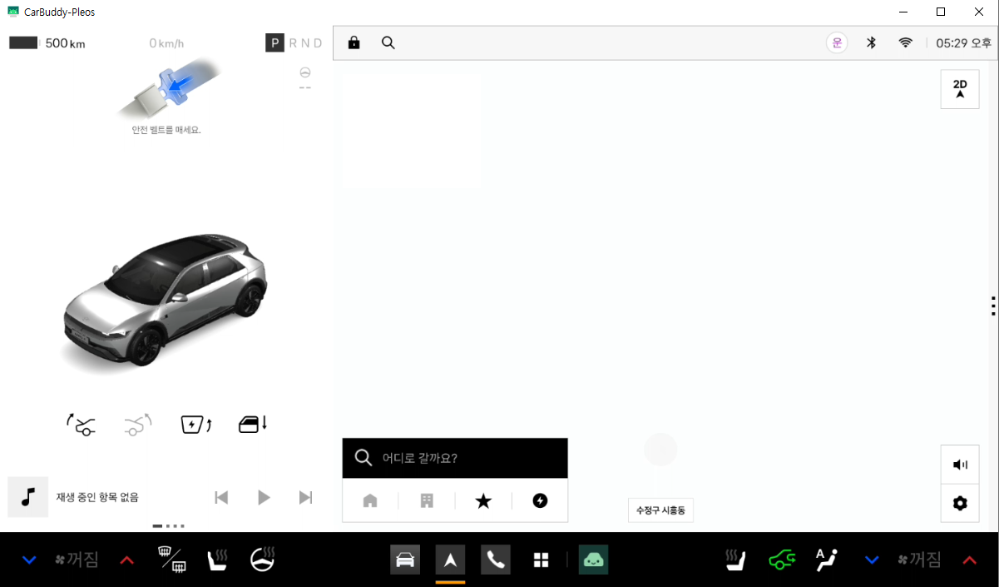
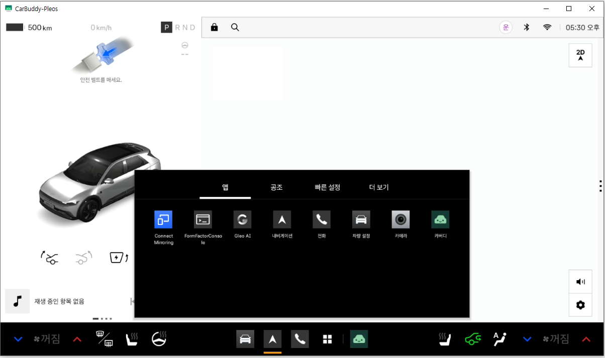
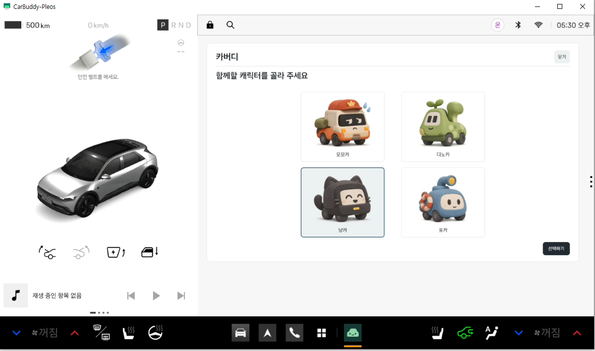
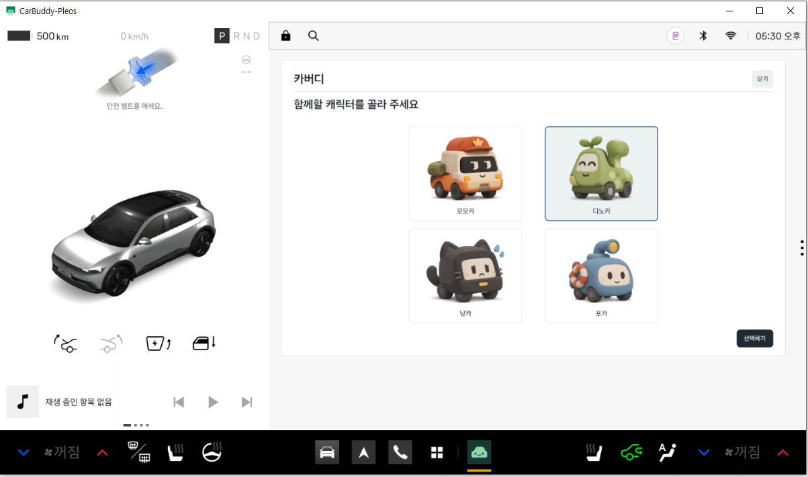
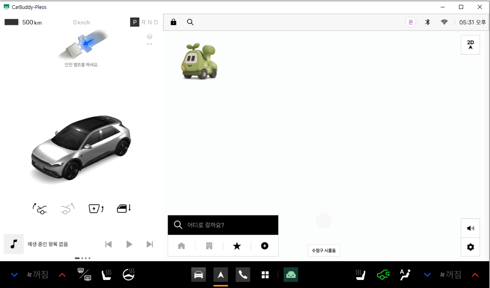
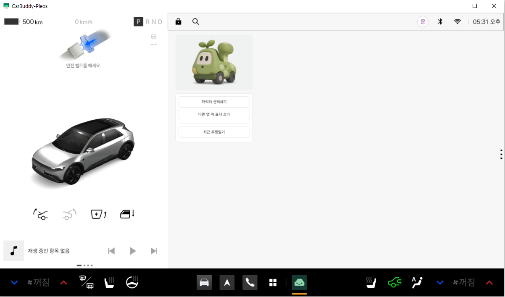
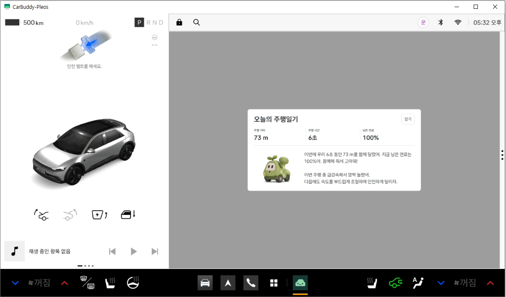

# 카버디 CarBuddy

차량 상태에 반응하는 자동차 캐릭터와 주차 후 읽는 주행 일기입니다. Pleos Connect용 Java 앱이며 Android Automotive 표준 차량 API로 속도, 기어, 연료 정보를 읽고 Pleos NaviHelper로 내비게이션 이벤트를 받습니다.

## 시연 영상

[카버디 공모전 영상 · YouTube Shorts](https://www.youtube.com/shorts/T5bJXsuvAyQ)

## 구현 화면

### 1. Pleos 내비게이션 기본 화면



### 2. 앱 목록에서 카버디 열기



### 3. 캐릭터 선택 화면



### 4. 캐릭터를 바꿔 고를 때의 표정 변화



### 5. 내비게이션 위에 표시된 캐릭터



### 6. 캐릭터를 눌러 연 설정



### 7. 오늘의 주행일기



## Windows에서 바로 시연하기

1. GitHub에서 **Code → Download ZIP**으로 받은 저장소 전체를 압축 해제합니다.
2. 압축을 푼 폴더의 [`start-carbuddy-demo.bat`](start-carbuddy-demo.bat)를 더블클릭합니다. 실행 중인 Pleos 에뮬레이터 한 대가 있으면 그대로 사용합니다. 첫 설치라면 표시되는 Android SDK와 Pleos 약관을 읽고 동의한 후 다운로드와 부팅을 기다립니다.
3. 카버디가 Pleos에서 실행되고 차량 조작 화면이 PC의 기본 브라우저에서 열립니다. 기어를 **P**에 두고 아래 시연 순서의 2번부터 따라 합니다.

자동 설치는 Intel·AMD 기반 64비트 Windows용입니다. 첫 실행에는 인터넷 연결과 약 30GB의 여유 공간을 권장합니다. 설치 파일과 에뮬레이터는 `%LOCALAPPDATA%\CarBuddy\Pleos`에 저장되며, 다음 실행에서 재사용합니다. 가상화 설정 안내가 나오면 [Windows Hypervisor Platform 설정 방법](https://developer.android.com/studio/run/emulator-acceleration)에 따라 켠 뒤 재부팅하고 배치 파일을 다시 실행하세요.

## 실행

1. Android Studio에서 이 폴더를 엽니다. JDK 17과 Android SDK Platform 35가 필요합니다.
2. [Pleos Connect Emulator 설치 안내](https://document.pleos.ai/docs/connect/guide/getting-started/application-development/setup-connect-sdk-emulator)에 따라 API 34의 Pleos Connect AVD를 만들고 Cold boot로 시작합니다.
3. Android Studio에서 `app`을 실행하거나 PowerShell에서 `./gradlew.bat :app:assembleDebug :app:lintDebug`를 실행합니다.
4. 빌드 결과는 `app/build/outputs/apk/debug/app-debug.apk`에 생깁니다. 바로 시험할 수 있는 디버그 서명 사본은 `apk/moti_CarBuddy_release.apk`에 있습니다. APK는 Android Automotive용입니다.

## 에뮬레이터에서 시연하기

1. `adb forward tcp:8088 tcp:8088`을 실행한 뒤 [Virtual Console](http://127.0.0.1:8088/)을 브라우저에서 열어 둡니다.
2. 기어를 P에 두고 카버디를 실행합니다. 첫 실행에는 **모모카·디노카·냥카·포카**를 고릅니다. 다른 앱 위 표시가 허용된 상태에서 캐릭터를 고르면 Pleos의 이전 화면으로 돌아가고 캐릭터 그림이 떠 있습니다. 캐릭터를 누르면 설정이 열리며 **캐릭터 선택하기**에서 변경할 수 있습니다.
3. 처음에는 주차 중 **주행 기록 권한 허용**을 누릅니다. 이 에뮬레이터는 차량 속도 권한을 위치 정보 권한으로 표시합니다. 앱은 GPS나 위치 기록을 사용하지 않습니다.
4. **연료 정보 권한 허용**을 누르면 차량에서 읽은 연료량과 탱크 용량으로 계산한 **남은 연료**가 표시됩니다. 연료 신호를 읽을 수 없는 차량에서는 **조회 불가**로 표시됩니다. Pleos v2.1.0 Virtual Console에서 연료량을 조절하는 항목은 제공되지 않습니다. **표정 미리보기 → 연료 부족**에서 캐릭터 반응을 시연한 뒤 **자동 · 차량 상태 반영**으로 돌아갑니다.
5. 기존 Pleos 내비게이션에서 목적지를 설정합니다. 출발하면 카버디가 백그라운드에서 기록합니다. 중간에 P에 놓으면 기록을 보관한 채 화면을 그대로 두고, 다시 출발하면 기록을 이어갑니다.
6. 내비게이션 최종 도착 신호와 P를 모두 확인하면 **오늘의 주행일기** 버튼이 뜹니다. 누르면 별도 창에 전체 일기와 캐릭터가 함께 표시됩니다. 도착 신호가 없는 환경에서는 최종 주차 후 카버디 앱을 열어 **주행 끝내기**를 선택합니다. 이전 기록은 설정의 **최근 주행일기**에서 다시 열 수 있습니다.

### 다른 앱 위에 캐릭터 띄우기

최초 설정을 완료하면 Android가 부팅 후 시작 신호를 보낼 때 카버디가 자동 시작됩니다. 차량이 주차 중이고 다른 앱 위에 표시할 권한이 있으면 내비게이션 등의 화면에 카버디 그림이 배경 없이 뜹니다. 캐릭터를 끌어서 옮기거나 탭해서 카버디 설정을 열 수 있습니다. 설정에서 다른 앱 위 표시를 끌 수 있습니다.

현재 Pleos Connect 에뮬레이터 이미지에서는 표시 권한 설정 화면이 열리지 않습니다. 개발용 에뮬레이터 한 대에서 시연할 때는 APK를 설치한 후 아래 명령을 실행하고 카버디를 다시 엽니다.

```powershell
adb -e shell cmd appops set --user current app.carbuddy SYSTEM_ALERT_WINDOW allow
```

## 검증 범위

- Pleos Connect v2.1.0 이미지, Android API 34, Vehicle Service 2.3.22, 1920×1080 에뮬레이터에서 설치와 실행을 확인했습니다.
- 에뮬레이터 재시작 후 주차 중 캐릭터 자동 표시, 내비 목적지 검색과 경로 안내, 캐릭터 이동을 확인했습니다. 최종 도착과 P의 처리 순서는 코드 검사에서 검증했습니다.
- Pleos Connect 에뮬레이터에서 연료 권한을 허용한 뒤 잔량을 읽을 수 있음을 확인했습니다. [Android Automotive 연료 속성](https://developer.android.com/reference/android/car/VehiclePropertyIds#FUEL_LEVEL)
- Android Automotive의 속도와 기어 신호를 이용해 이동 거리와 움직인 시간을 계산합니다. 중간 주차 시간은 합계에서 제외합니다. 중간 주차 중 앱을 다시 실행해도 저장한 구간부터 이어집니다.
- 거리와 시간은 추정치입니다. 첫 출발 전에 카버디 설정과 주행 기록 권한 허용을 마쳐야 합니다. 이동 중 속도 신호가 5초 넘게 끊기거나 앱 프로세스가 종료되면 해당 이동의 전체 합계를 확인할 수 없습니다.
- 내비 제한속도를 받으면 속도 초과 판단에 사용합니다. 신호가 없으면 80 km/h를 앱 기준으로 씁니다. 급가속과 급감속은 연속 속도 샘플에서 변화율이 3.5 m/s² 이상일 때 기록합니다. 일기에는 유형별 첫 지점을 출발 후 이동 거리로 표현합니다. 주행 제한 중에는 캐릭터 표시를 숨깁니다. 연료 부족 기준은 20% 이하이며 음악 재생은 Android의 활성 미디어 신호를 읽습니다.
- 실차·상용 서명·스토어 심사는 검증하지 않았습니다. 경적·노면 충격·주차 센서 반응은 범위에서 제외했습니다.

## 코드 확인

```powershell
javac -encoding UTF-8 -d app/build/trip-check app/src/main/java/app/carbuddy/TripStory.java app/src/main/java/app/carbuddy/TripMeter.java checks/TripStoryCheck.java
java -ea -cp app/build/trip-check app.carbuddy.TripStoryCheck
```

로컬 접수 양식에는 팀 연락처가 들어 있어 Git에서 제외했습니다. 접수에는 각 팀원이 직접 동의 여부·서명·날짜를 작성해야 합니다. 테스트 APK는 공식 제출용 release APK가 아닙니다. [공식 제출 안내](https://appdevchallenge.auto-hmg.io/guide/submission)
